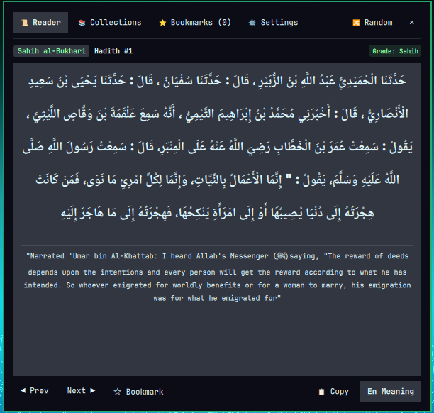
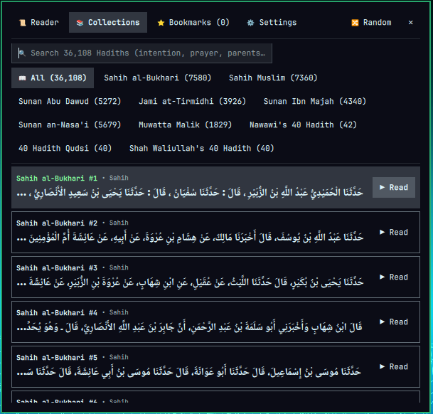
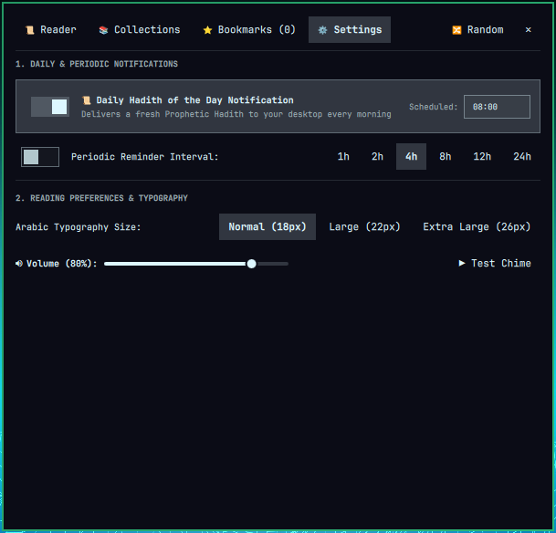

# Omarchy Hadith Plugin (`abdulrahman.hadith`)

[](https://omarchyplugins.com)
[](https://github.com/abdalrohman)
[](LICENSE)
[](manifest.json)
[-teal)](https://ummahapi.com)

A native, elegant Prophetic Hadith reader, daily wisdom reminder & 10-collection explorer for the **Omarchy Desktop** (Quickshell). Integrates the complete [UmmahAPI](https://ummahapi.com/api/docs) Hadith catalog covering **10 major collections** and **36,000+ authentic Hadiths**, daily Hadith of the Day scheduling, bookmarks, and a multi-action status bar widget.

Developed by [@abdalrohman](https://github.com/abdalrohman).

---

<p align="center">
  
</p>

<p align="center">
  
</p>

<p align="center">
  
</p>

---

## ✨ Features

### 📜 Menubar Widget (`BarWidget.qml`)
- **Real-Time Display**: Positioned in the active bar with Islamic Scroll glyph (`📜`), showing current Hadith collection and number, short Arabic excerpt, or countdown timer.
- **Multi-Action Interactions**:
  - **Left-Click**: Open and toggle the detailed popup panel.
  - **Middle-Click**: Fetch a fresh random Hadith directly from the bar.
  - **Right-Click**: Cycle through widget display formats.
  - **Scroll Wheel**: Quick navigate between Previous / Next Hadiths.
- **Multiple Display Formats** (Right-Click to cycle):
  1. `[Icon]` only (Default)
  2. `[Icon] Collection #Number` (e.g. `📜 Sahih al-Bukhari #1`)
  3. `[Icon] Excerpt` (e.g. `📜 إنما الأعمال بالنيات…`)
  4. `[Icon] Next in Xh` (e.g. `📜 3h 45m`)

---

### 📖 Popup Details Panel (`Panel.qml`)

#### 1. Active Hadith Reader
- **Calligraphy Display**: Clear, high-readability Arabic typography with diacritics (Tashkeel) and customizable font sizing (`Normal 20px`, `Large 24px`, `XL 28px`).
- **English Translation**: Accurate English meanings with toggleable display.
- **Authenticity Badges**: Collection name, Hadith number, and authenticity grade (`Grade: Sahih` / `Grade: Hasan`).
- **Action Toolbar**:
  - ⭐ **Bookmark**: Star and pin Hadiths for future reference.
  - 🔀 **Random**: Fetch a fresh random Hadith instantly (`Spacebar`).
  - ◀ / ▶ **Navigation**: Previous and Next Hadiths.
  - 📋 **Copy**: Quick copy Arabic text, English translation, and Hadith citation to clipboard.

#### 2. 10 Major Hadith Collections & Live Search
- **Major Collections Supported (36,000+ Hadiths)**:
  - *Sahih al-Bukhari* (7,580 hadiths)
  - *Sahih Muslim* (7,360 hadiths)
  - *Sunan Abu Dawud* (5,272 hadiths)
  - *Jami` at-Tirmidhi* (3,926 hadiths)
  - *Sunan an-Nasa'i* (5,679 hadiths)
  - *Sunan Ibn Majah* (4,340 hadiths)
  - *Muwatta Malik* (1,829 hadiths)
  - *Nawawi's 40 Hadith* (42 hadiths)
  - *40 Hadith Qudsi* (40 hadiths)
  - *Shah Waliullah's 40 Hadith* (40 hadiths)
- **100% Offline-First Core Dataset**: Bundled locally with all 42 Nawawi Hadiths, 40 Hadith Qudsi, and foundational Sahih Bukhari/Muslim traditions for instant zero-latency access.
- **Live Search**: Search in real time across keywords, narrators, topics, and Hadith numbers.

#### 3. Bookmarks & Personal Library
- Save your favorite Prophetic traditions to your personal bookmarks with 1-click reading or removal.

#### 4. Daily & Periodic Notifications
- 🌅 **Daily Hadith of the Day**: Scheduled desktop notification every morning (default: `08:00`).
- ⏳ **Periodic Reminder**: Configurable intervals (`1h`, `2h`, `4h`, `8h`, `12h`, `24h`) with gentle chime audio.

---

## ⌨️ Keyboard Shortcuts

| Shortcut | Action |
|---|---|
| `Space` | Fetch new random Hadith |
| `N` / `L` | Next Hadith |
| `P` / `H` | Previous Hadith |
| `B` / `F` | Bookmark / Favorite current Hadith |
| `1` | Switch to **Hadith Reader** tab |
| `2` | Switch to **Collections & Search** tab |
| `3` | Switch to **Bookmarks** tab |
| `4` | Switch to **Settings** drawer |
| `Esc` | Close panel |

---

## 🛠️ Installation & Activation

### Method 1: Via Omarchy CLI (Recommended)
```bash
omarchy plugin add https://github.com/abdalrohman/omarchy-hadith --enable
```

### Method 2: Manual Installation
1. Clone the repository into your Omarchy plugins directory:
```bash
git clone https://github.com/abdalrohman/omarchy-hadith.git ~/.config/omarchy/plugins/abdulrahman.hadith
```

2. Enable the plugin in your center bar:
```bash
omarchy plugin enable abdulrahman.hadith center
```

3. Restart your Omarchy shell:
```bash
omarchy restart shell
```

---

## 📄 License
Released under the [MIT License](LICENSE) by [@abdalrohman](https://github.com/abdalrohman).
